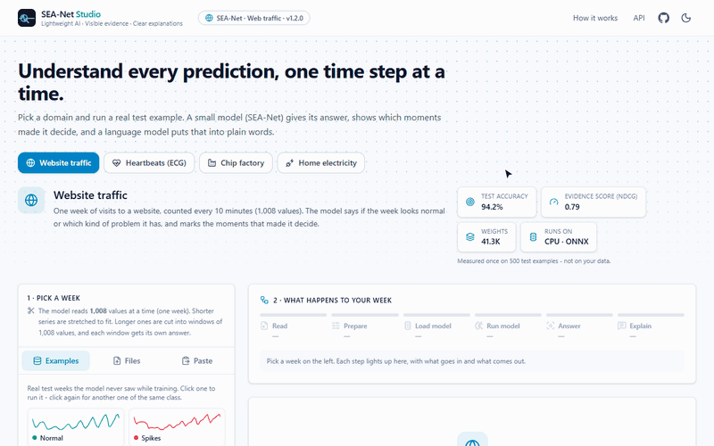
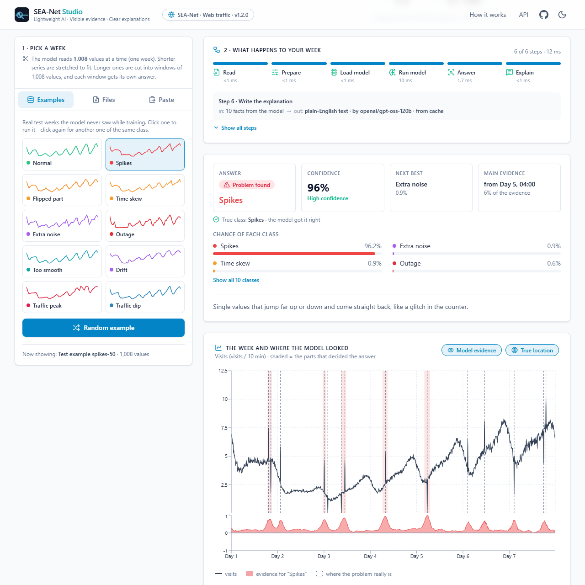
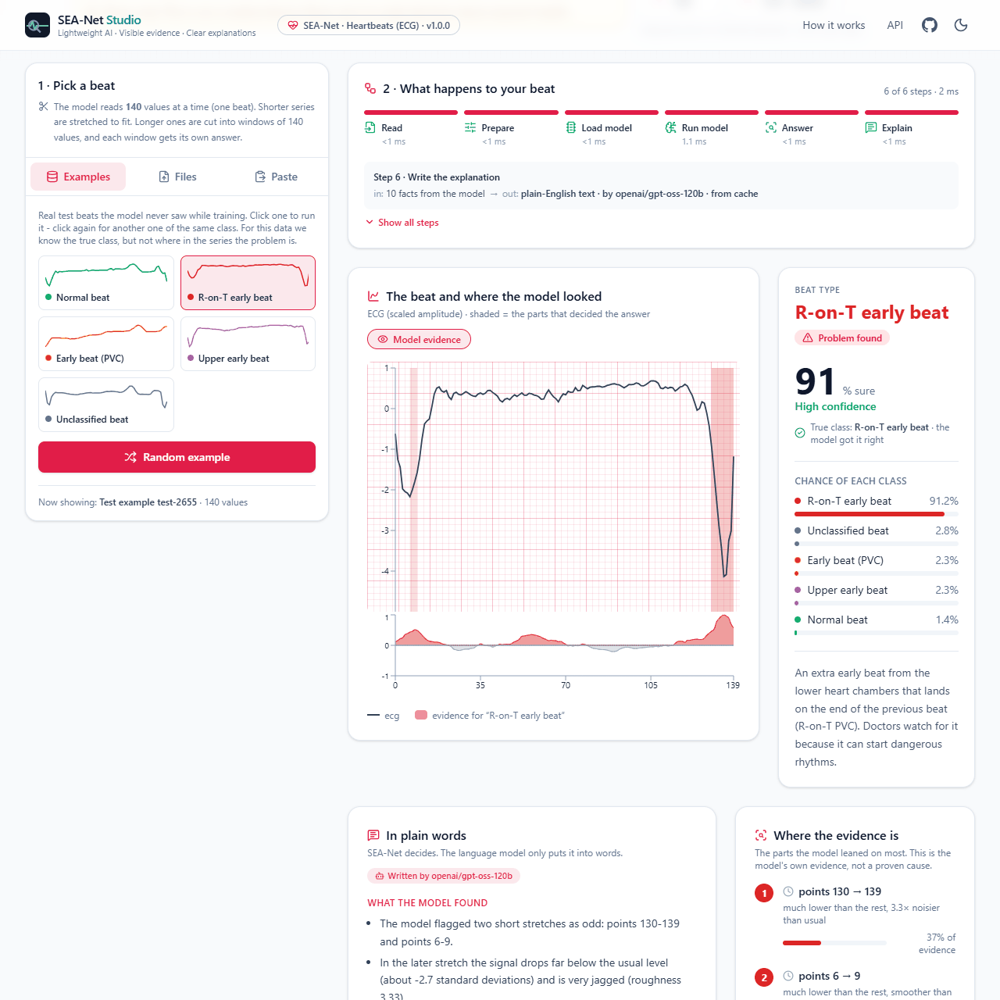
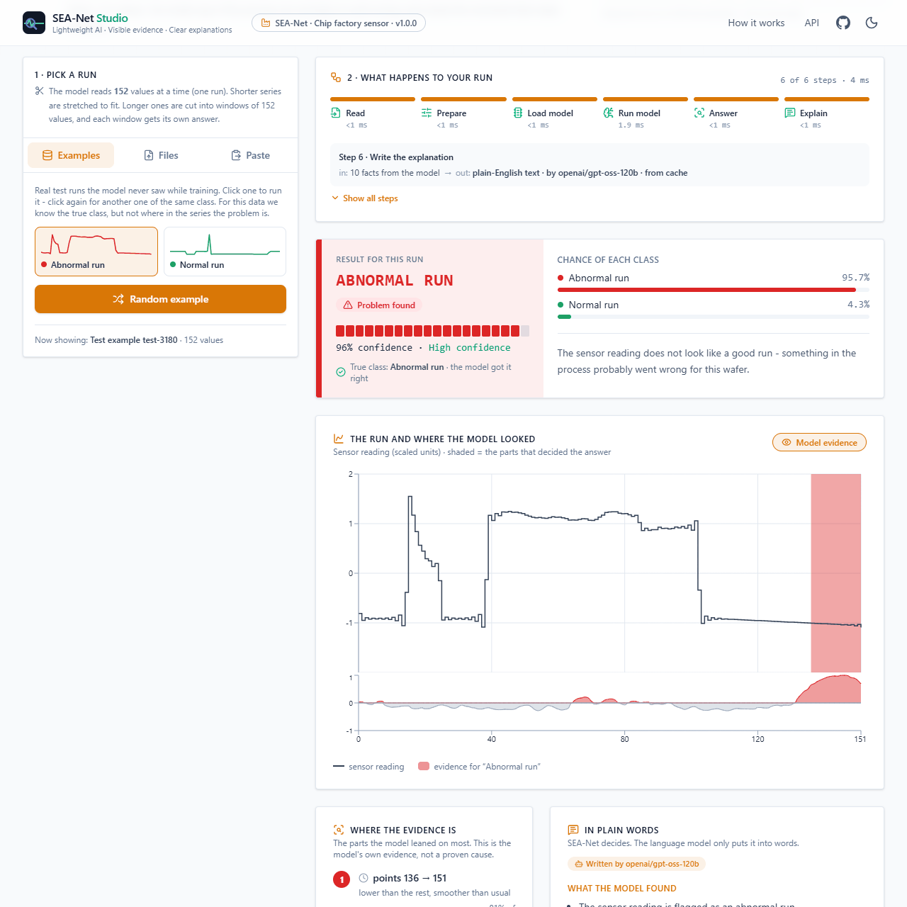
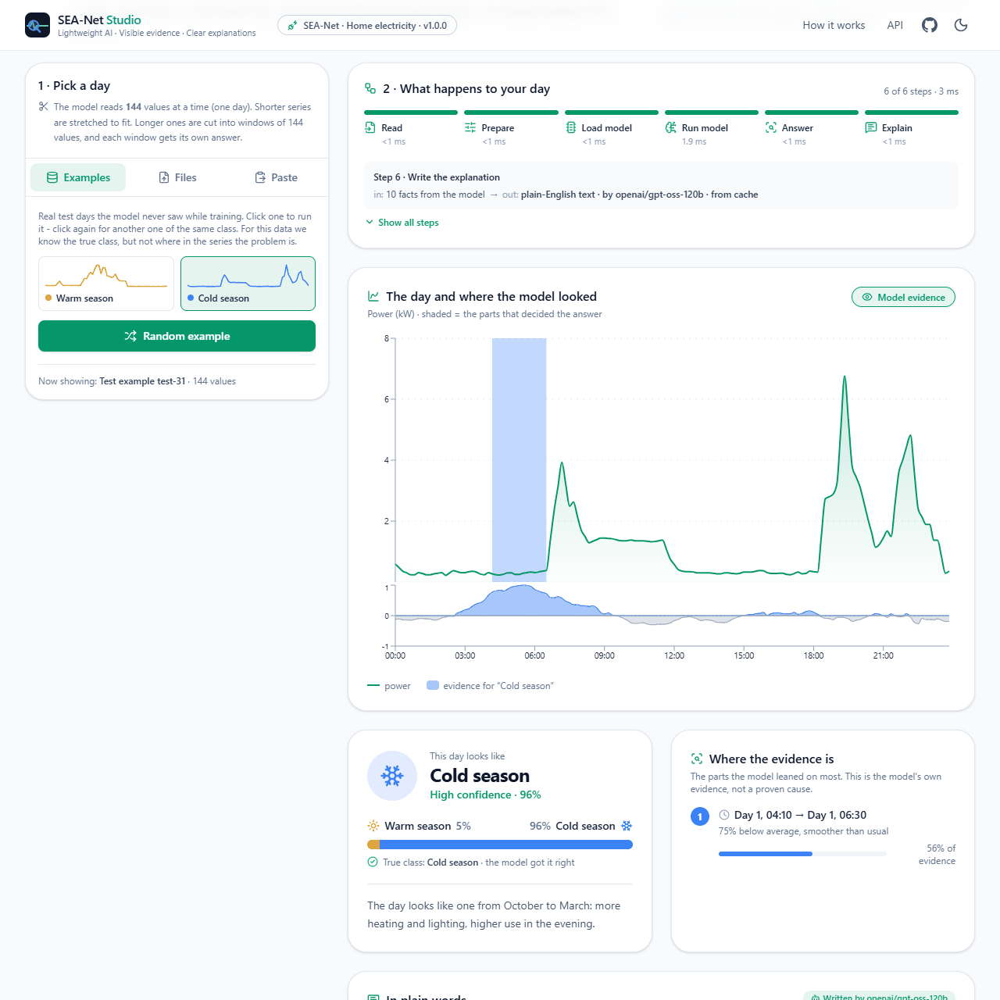
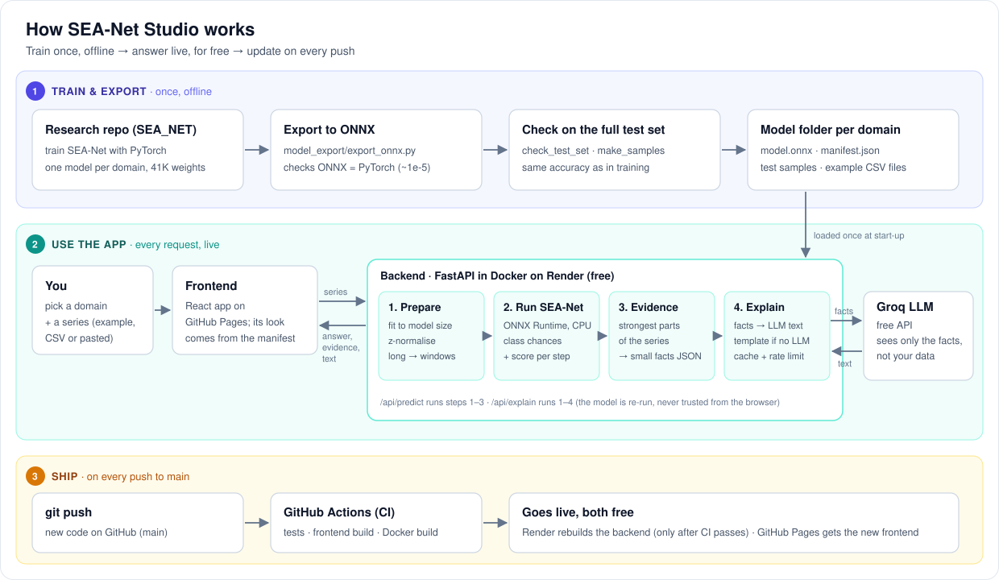

<div align="center">

# SEA-Net Studio

**Lightweight AI. Visible evidence. Clear explanations.**

An interpretable time-series AI you can try in the browser: it labels a signal, highlights the
moments that made it decide, and explains the result in plain English.

### [▶ Try the live app](https://ubaidur404786.github.io/seanet-studio/)

<sub>Free hosting: if nobody used it in the last 15 minutes, the server needs about a minute to wake up.</sub>

[](https://github.com/ubaidur404786/seanet-studio/actions/workflows/ci.yml)




</div>

## Four domains, one model design

<table>
  <tr>
    <td width="50%" align="center"><b>Website traffic</b><br><sub>a normal week or 1 of 9 problems</sub></td>
    <td width="50%" align="center"><b>Heartbeats (ECG)</b><br><sub>a normal beat or 1 of 4 irregular beats</sub></td>
  </tr>
  <tr>
    <td></td>
    <td></td>
  </tr>
  <tr>
    <td width="50%" align="center"><b>Chip factory</b><br><sub>a normal or an abnormal production run</sub></td>
    <td width="50%" align="center"><b>Home electricity</b><br><sub>a warm-season or a cold-season day</sub></td>
  </tr>
  <tr>
    <td></td>
    <td></td>
  </tr>
</table>

Each domain has its own look (layout, icons, colours, chart style), chosen by one line in its
manifest. The numbers never change with the look.

## Architecture



The model decides, the language model only writes: the LLM gets a small set of facts computed by
the model and nothing else. More in [How it works](docs/how-it-works.md).

## What it does

1. **Pick a domain and a series:** a real test example, a CSV file, your own file, or pasted numbers.
2. **SEA-Net answers:** a small interpretable model (41 K weights, run with ONNX Runtime on CPU)
   says which class the series belongs to.
3. **It shows its evidence:** the model scores every time step, so the app shades the moments that
   decided the answer. For web traffic you can also switch on the **true** problem location.
4. **It explains in plain words:** a free LLM writes a short explanation from the model's facts.
   "What the language model got" shows exactly what it was sent.
5. **It shows every step:** a progress bar above the charts plays the real pipeline
   (read → prepare → load model → run → answer → explain) with real timings.

## The models

| Domain | Dataset | Test accuracy | Average over classes |
|---|---|---|---|
| Website traffic | WebTraffic | 94.2 % | 94.2 % |
| Heartbeats (ECG) | ECG5000 | 94.4 % | **56.1 %** |
| Chip factory | Wafer | 99.9 % | 99.9 % |
| Home electricity | PowerCons | 93.9 % | 93.9 % |

Measured again on the full test sets through the app's own ONNX files: the same accuracy as in
training. The ECG model misses many rare beat types, and the app says so. Details, per-class
numbers and how to add a domain: [docs/models.md](docs/models.md).

## Tech stack

| Layer | Tools |
|---|---|
| Model | PyTorch (training, in a private research repo) → ONNX (opset 17) |
| Inference | ONNX Runtime, NumPy |
| API | FastAPI, Pydantic, httpx (async LLM calls), GZip, per-visitor rate limit |
| LLM | any OpenAI-compatible free API: Groq (default, `openai/gpt-oss-120b`), Google Gemini, or a local Ollama |
| Frontend | React 19, TypeScript, Vite, Tailwind CSS 4, Recharts, responsive + dark mode |
| Ops | Docker, GitHub Actions (CI + deploy), Render (backend) + GitHub Pages (frontend), both free |

## Quick start

```bash
# terminal 1 - the API (works without an LLM key, the text then comes from a template)
cd backend
pip install -r requirements-dev.txt
uvicorn app.main:app --port 8000

# terminal 2 - the web app
cd frontend
npm install
npm run dev                                # open http://localhost:5173
```

Tests, the LLM key, Docker and the project layout: [docs/development.md](docs/development.md).

## Documentation

| Page | What is in it |
|---|---|
| [How it works](docs/how-it-works.md) | the model, one request step by step, why ONNX, the pipeline bar, the domain templates |
| [The models](docs/models.md) | the four models, per-class results, adding a domain, limits |
| [Run it locally](docs/development.md) | setup, tests, LLM providers, Docker, project structure |
| [Deploy for free](docs/deployment.md) | GitHub Pages + Render, one-time setup, sleeping |
| [API](docs/api.md) | endpoints and a `curl` example |

## Limits

- Each model is trained on one dataset (one website benchmark, one patient, one production line,
  one household). Very different real data can get confident but wrong answers.
- The ECG demo is **not a medical device**.
- The text is written by an LLM from the model's facts; the chart is the ground truth.

Full list: [docs/models.md#limits](docs/models.md#limits).

## Credits

- MILLET and the WebTraffic dataset: Early et al., *Inherently Interpretable Time Series
  Classification via Multiple Instance Learning*, ICLR 2024 -
  [JAEarly/MILTimeSeriesClassification](https://github.com/JAEarly/MILTimeSeriesClassification) (Apache 2.0).
- SEA-Net model and training: the research code and the model design are private for now
  (research in progress); this repo only runs the trained, exported models.

License: Apache 2.0.
