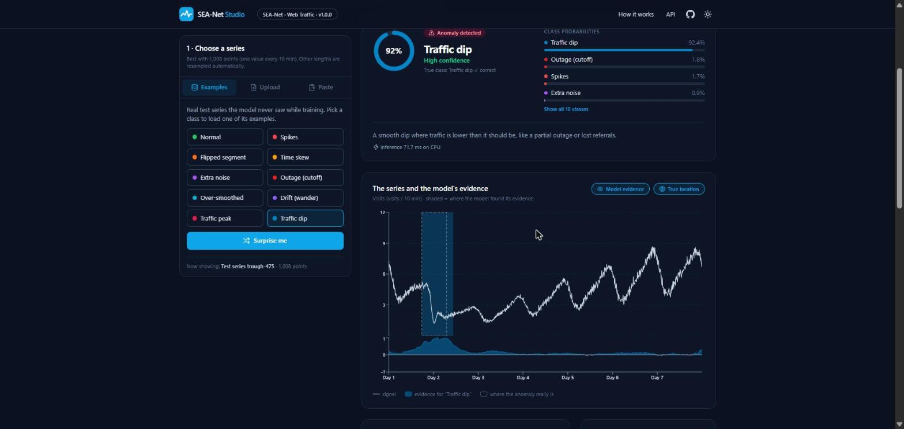
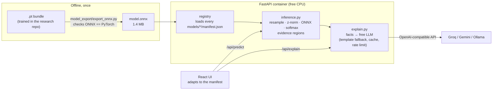

# SEA-Net Studio

**Lightweight AI. Visible evidence. Clear explanations.**

An interpretable time-series AI you can actually use: it classifies a signal, points at the exact
moments that made it decide, and explains the result in plain English.

[](https://github.com/ubaidur404786/seanet-studio/actions/workflows/ci.yml)


**Live demo:** https://ubaidur404786.github.io/seanet-studio/
(free hosting: if nobody used it in the last 15 minutes, the server needs about a minute to wake up)



---

## What it does

1. You pick a domain (web traffic, heartbeats, chip factory, home electricity) and give it a series:
   a real test example, a real CSV file, your own file, or pasted numbers.
2. **SEA-Net**, a small model I designed and trained during my research internship, says which class
   the series belongs to - for example a normal week or one of 9 kinds of web-traffic problem, or
   which kind of heartbeat it is.
3. The model also gives a score **for every time step**, so the app shades the moments that
   convinced it. For the web-traffic test examples you can switch on the **true** anomaly location
   and check the model against reality.
4. A **free LLM** turns those facts into a short explanation anyone can read. You can open
   "What the language model got" to see the exact facts it was given.
5. Every step (read → prepare → load model → run → answer → explain) is shown in a progress bar
   above the charts, with what went in, what came out and how long it really took.

Each domain has its own look (layout, icons, colours, chart style), picked by one line in its
manifest - see [Domain templates](#domain-templates).

The key design choice: **SEA-Net decides, the LLM only writes.** The LLM receives a small JSON of
facts computed by the model (class, confidence, evidence regions, what the signal does there) and
strict rules to use nothing else. If no LLM is configured, or the free quota runs out, the app
falls back to a template explanation and keeps working.

## The model

SEA-Net is a multiple-instance-learning classifier: a series is a "bag" and each time step is an
"instance". The explanation is part of the forward pass, not a separate tool added afterwards.

| | SEA-Net (this app) | MILLET (ICLR 2024 baseline) |
|---|---|---|
| Test accuracy, WebTraffic | **94.2 %** | 91.6 % |
| Evidence quality, NDCG@n | **0.786** | 0.624 |
| Parameters | **41 K** | 424 K |
| Inference here | ~10 ms on CPU (ONNX Runtime) | - |

Architecture: a multi-scale separable temporal-convolution encoder (`sea_mstcn_sep_bottleneck`,
kernels 5/11/23, dilations up to 16) + a **Top-k Conjunctive** pooling head: every time step gets a
gated score per class, and the class score is the mean of the strongest 10 %.
Numbers are seed 0 from the research repo; see [Limits](#limits) before reading too much into them.

## Architecture



**Why ONNX:** the backend needs only `onnxruntime` + `numpy`, no PyTorch and no research code.
The Docker image stays small, it starts fast on free hosting, and the export script proves the
ONNX file gives the same answers as PyTorch (max difference ~1e-5).

**Why a manifest:** each model folder has a `manifest.json` with its domain (title, signal name,
unit, sampling interval, accent colour), its classes (labels, colours, normal vs anomaly,
descriptions) and the kinds of output it gives. The frontend builds its screens from that file, so
a model for another domain is a new folder, not new frontend code.

## Tech stack

| Layer | Tools |
|---|---|
| Model | PyTorch (training, in the research repo) → ONNX (opset 17) |
| Inference | ONNX Runtime, NumPy |
| API | FastAPI, Pydantic, httpx (async LLM calls), GZip, per-visitor rate limit |
| LLM | any OpenAI-compatible free API: Groq (default, `openai/gpt-oss-120b`), Google Gemini, or a local Ollama |
| Frontend | React 19, TypeScript, Vite, Tailwind CSS 4, Recharts, responsive + dark mode |
| Ops | Docker (multi-stage), GitHub Actions (CI + deploy), Render (backend) + GitHub Pages (frontend), both free |

## Run it locally

You need Python 3.11+ and Node 20+.

```bash
# 1. backend
cd backend
pip install -r requirements-dev.txt
python -m pytest -q                         # 24 tests, uses the real models
cp ../.env.example .env                     # then paste a free key into .env (optional)
uvicorn app.main:app --reload --port 8000 --env-file .env
# note: --reload picks up code changes, NOT .env changes. after editing .env, stop and start again

# 2. frontend (second terminal)
cd frontend
npm install
npm run dev                                 # open http://localhost:5173
```

Without a key everything works, the explanation just comes from the template.
Free keys: [Groq](https://console.groq.com/keys) or [Google AI Studio](https://aistudio.google.com/apikey).

**When the LLM does not work.** Free providers retire models (Groq dropped `llama-3.3-70b-versatile`;
on 2026-10-13 `openai/gpt-oss-120b` worked). At start-up the server asks the provider for its model
list and writes one line in the log: `LLM check: ... is available`, or a warning with the models it
does offer. `GET /api/health` shows the same check. When a call fails, the explanation card says why
(e.g. `404 model_not_found`) and the template is used instead.

Or everything in one container:

```bash
docker build -t seanet-studio .
docker run -p 7860:7860 -e LLM_API_KEY=your_key seanet-studio   # open http://localhost:7860
```

## Deploy for free (GitHub Pages + Render)

The product is split over two free hosts:

| Part | Host | What runs there | Set up by |
|---|---|---|---|
| Frontend | GitHub Pages | the built React files (plain static files) | `.github/workflows/deploy.yml` |
| Backend | Render, free web service (Docker, 512 MB) | FastAPI + ONNX Runtime + the 4 models (~170 MB of RAM). It also serves the app itself, as a backup | `render.yaml` |

The two are on different hosts, so two settings connect them: the frontend is built with
`VITE_API_URL` = the Render address, and the backend gets `ALLOWED_ORIGINS` = the Pages address
(CORS, otherwise the browser blocks the calls). The LLM key is a Render **secret**, it never reaches
the browser.

One-time setup:

1. [render.com](https://render.com) → sign in with GitHub → **New → Blueprint** → pick this repo.
   Render reads `render.yaml`, asks for `LLM_API_KEY` (your free Groq key; leave it empty for the
   template text) and builds the Docker image (a few minutes).
2. In this GitHub repo: Settings → Secrets and variables → Actions → variable `API_URL` =
   the Render address, e.g. `https://seanet-studio.onrender.com`.
3. Settings → Pages → Source: **GitHub Actions**, then run `gh workflow run deploy.yml`.

After that both parts update by themselves: Render rebuilds the backend when CI passes on `main`,
and the Pages workflow republishes the frontend when a commit changes `frontend/`.
If you do not use Groq, add `LLM_BASE_URL` / `LLM_MODEL` in the Render dashboard (Environment).

**Why not Hugging Face Spaces?** It was the first plan, but since 2026 a Docker Space on the free
CPU needs a PRO subscription (creating one fails with `402 Payment Required`); only static Spaces
stay free.

**Sleeping.** A free Render service sleeps after 15 minutes without visitors and needs about a
minute to wake up. The app then shows "Waking up the free server…" and keeps trying by itself, so
the first visitor only has to wait.

## API

Interactive docs at `/api/docs`.

| Method | Path | What |
|---|---|---|
| GET | `/api/health` | status, loaded models, LLM on/off + the start-up model check |
| GET | `/api/models` | each model's public card (domain, classes, stats) |
| GET | `/api/models/{id}/samples[/{sid}]` | test examples with a small preview (+ true anomaly location) |
| GET | `/api/models/{id}/examples/{name}` | a real example CSV file |
| POST | `/api/models/{id}/predict` | `{"values": [...]}` → one result per window + the pipeline steps |
| POST | `/api/models/{id}/explain` | `{"values": [...], "window": 0}` → the result + a plain-English explanation |

`/explain` re-runs the model on the server instead of trusting a result sent by the browser, so the
LLM can only ever explain what the model really said.

## Project structure

```text
model_export/
  export_onnx.py     .pt bundle -> model.onnx, checked against PyTorch
  check_test_set.py  the whole test split through model.onnx -> accuracy + per-class numbers
  make_samples.py    picks real test series + writes example CSV files
  manifests/         the domain cards (one per model)
backend/
  app/
    config.py        every setting from env variables (provider = 3 variables)
    registry.py      loads models/*/manifest.json + model.onnx once at start-up
    inference.py     resample, z-normalise, run ONNX, softmax, evidence regions
    explain.py       facts -> LLM prompt, start-up model check, template fallback, cache, rate limit
    main.py          FastAPI routes, serves the built frontend
  models/            webtraffic-seanet, ecg5000-seanet, wafer-seanet, powercons-seanet
  tests/             numpy helper tests, LLM helper tests, end-to-end API tests on the real models
frontend/src/
  App.tsx            state + page, picks the domain's template
  lib/templates.ts   the 4 domain templates (layout, answer style, chart style)
  components/        Header, Logo, Hero, InputPanel, PipelineBar, ResultLayout, PredictionCard,
                     SeriesChart, EvidenceList, ExplanationCard, HowItWorks
Dockerfile           node build stage + python runtime stage, one container
.github/workflows/   CI (tests, build, docker) and the frontend deploy to GitHub Pages
render.yaml          the backend on Render (free Docker web service)
```

## The models (one per domain)

SEA-Net Studio holds **only the final trained models**, ready for inference. Every model is the same
SEA-Net design (`top_bottleneck_topk`, seed 0, ~41 K weights), trained in the research repo on one
dataset each. Domains were picked because they are useful in real life **and** SEA-Net does well on them.

The numbers below are the **shipped** models, measured again on the full test split through the
app's own ONNX file and preprocessing (`model_export/check_test_set.py`). All four give exactly the
same accuracy as their training run, which shows the app runs the models faithfully.

| Domain | Dataset | What it answers | Test accuracy | Average over classes | True evidence location? |
|---|---|---|---|---|---|
| Website traffic | WebTraffic | normal week or 1 of 9 problems | 94.2 % | 94.2 % | yes |
| Heartbeats (ECG) | ECG5000 | normal beat or 1 of 4 irregular beats | 94.4 % | **56.1 %** | no |
| Chip factory | Wafer | normal or abnormal production run | 99.9 % | 99.9 % | no |
| Home electricity | PowerCons | warm-season or cold-season day | 93.9 % | 93.9 % | no |

"Average over classes" counts every class the same. For ECG5000 it is much lower: most beats are
normal (99.9 % found) or R-on-T (95 %), but the model finds only 32 of 86 PVC beats, 77 of 175
upper early beats and 1 of 22 unclassified beats. The app shows this per-class table, warns in
the explanation when the answer is one of those weak classes, and says clearly that it is not a
medical device.

Only WebTraffic says WHERE the problem really is, so only there can you compare the model's
evidence with the truth. For the others the app shows the model's own evidence only.

Each model folder in `backend/models/<id>/` has `model.onnx`, `export_info.json`, `manifest.json`
(the domain card the UI is built from), `samples.json` and `examples/` (real CSV files).
The domain cards live in `model_export/manifests/`. A domain shows up in the app as soon as its
folder exists - no code change.

### Adding a domain model

Nothing is trained in this repo. Train in the research repo (with `output.save_deploy: always`
in `configs/main.yaml`, so the deploy bundle is saved for UCR datasets too), write a manifest in
`model_export/manifests/`, then export, check and pick samples (example: ECG5000):

```bash
# in SEA_NET (GPU recommended)
python main.py single ECG5000 --model top/top_bottleneck_topk

# in seanet-studio
python model_export/export_onnx.py --seanet-repo ../SEA_NET --bundle results/top_results/SEA_NET/top_bottleneck_topk__sea_mstcn_sep_bottleneck__sea_topk_conjunctive/deploy/ECG5000__seed0.pt --manifest model_export/manifests/ecg5000-seanet.json --out-dir backend/models/ecg5000-seanet
python model_export/check_test_set.py ucr --dataset ECG5000 --data-dir ../SEA_NET/data/UCR/ECG5000 --model-dir backend/models/ecg5000-seanet
python model_export/make_samples.py ucr --dataset ECG5000 --data-dir ../SEA_NET/data/UCR/ECG5000 --out-dir backend/models/ecg5000-seanet --signal ecg --one-class 1 --long-classes 0 1 0 2 --item beat beats
```

The other shipped models used:

| Model | make_samples.py options |
|---|---|
| WebTraffic | `webtraffic --interval-min 10 --signal visits --long-classes 0 5 0 9 --item week weeks` |
| Wafer | `ucr --dataset Wafer --signal sensor --one-class 0 --long-classes 1 1 0 1 --item run runs` |
| PowerCons | `ucr --dataset PowerCons --signal power --interval-min 10 --one-class 1 --long-classes 0 0 1 1 --item day days` |

The manifest fields that shape the UI: `domain.template` (see below), `domain.item` (what one input
is called: "beat", "day"...), `domain.warning` (shown big, e.g. "not a medical device"),
`domain.accent` (colour), `order` (position of the domain tab), and per class `kind`
(normal / anomaly / category), `color` and an optional `icon`.

## Domain templates

Each domain picks one of four templates in its manifest. A template changes the **look**, never the
numbers: the same blocks (answer, chart, explanation, evidence) are arranged and drawn differently.

| Template | Used by | Layout | Answer card | Chart |
|---|---|---|---|---|
| `monitoring` | Website traffic | stat tiles, then a wide chart | 4 tiles: answer, confidence, next best, main evidence | thin line, dashed grid |
| `clinical` | Heartbeats | chart and a readout column side by side | big "% sure" readout | straight-line trace on ECG paper |
| `industrial` | Chip factory | pass / fail strip first, evidence before text | mono strip + 20-block gauge | step line, blueprint grid |
| `energy` | Home electricity | the day's curve first | big season icon + warm / cold split bar | filled area |

The layout and chart part is in `frontend/src/lib/templates.ts`; the CSS part (card corners, title
style, hero background: dot grid, ECG paper, blueprint, sunrise) is keyed on `data-template` in
`frontend/src/index.css`.

## Long and short series

The ONNX model takes a fixed number of values (1,008 for WebTraffic, 140 for ECG5000...).

- **Exactly that length** - used as it is.
- **Shorter** - stretched to that length; the evidence is mapped back onto your own points.
- **Longer** - cut into windows of that length, and each window is predicted on its own (all
  windows in one ONNX call). If the last piece is too short, the last window is taken from the
  end, so it overlaps the one before. The UI shows one block per window; click one to see its
  chart, evidence and explanation.

## Pipeline view

The backend times every step and describes its input and output in a few words
(`read → prepare → load model → run → read the answer → write the explanation`). A horizontal
progress bar above the charts shows these real numbers one step at a time; click a finished step to
see what went in and out, or open "Show all steps". The model itself takes a few ms, so the bar is
played at a pace a person can follow - only the pace is slowed, the numbers are the measured ones.

Below the results, "How it works" keeps three kinds of numbers apart: the **model card** (facts
about the file), **test results** (measured once on the test split) and **this session** (timed live
on your last run).

## Limits

- WebTraffic is a **synthetic** benchmark of 1,008-point weeks. Real traffic that looks very
  different can get confident but wrong answers.
- ECG5000 is one patient with heart failure, labelled by a program. The model is weak on the rare
  beat types (see the table above). It is a demo, **not a medical device**.
- Wafer and PowerCons each come from one production line / one household.
- Series of another length are resampled, which can blur very short events.
- Every shipped model is one training seed. Over 3 seeds the research repo reports 0.931 ± 0.040
  WebTraffic accuracy for this architecture; on the 128-dataset UCR archive MILLET is still ahead,
  and on WebTraffic MILLET does better on the deletion test (AOPCR).
- The written explanation is produced by an LLM from the model's facts. It can still word things
  badly; the chart is the ground truth. The overall test accuracy is deliberately **not** sent to
  the LLM: it once turned 93.9 % into a made-up "94 of 100 days".

## Credits

- MILLET and the WebTraffic dataset: Early et al., *Inherently Interpretable Time Series
  Classification via Multiple Instance Learning*, ICLR 2024 -
  [JAEarly/MILTimeSeriesClassification](https://github.com/JAEarly/MILTimeSeriesClassification) (Apache 2.0).
- SEA-Net model and training: [ubaidur404786/sea-net](https://github.com/ubaidur404786/sea-net).

License: Apache 2.0.
